# Preference tournament

Measures a model's preferences over a broad set of tasks in two ways and compares
them:

- **Assistant**: the model, as the Assistant, chooses between two tasks.
- **Coinflip**: the model continues a *Human* turn that assigns one of two tasks
  by coin flip (the PSM coinflip setup, see `../coinflip`), and we read how it
  tilts the coin.

Each gives pairwise comparisons, from which we fit per-task utilities
(Bradley-Terry).

This builds on Gilg, Beckmann, Paleka and Butlin, [Probing Persona-Dependent
Preferences in Language Models](https://arxiv.org/abs/2605.13339) (2026;
[code](https://github.com/oscar-gilg/probing-persona-preferences)). Its 6,000-task
pool supplies every task here: the 300 tasks are drawn from it with its source
quotas, and the origin and topic analyses use its Claude Sonnet 4.5 topic labels.
The Assistant condition follows the paper's measurement, itself after Mazeika et
al. (2025): the model picks which of two tasks, labelled Task A and Task B, to
complete, and per-task utilities are fit from the pairwise choices. We read the
choice from the log-probs of a prefilled answer rather than sampling it, and fit
Bradley-Terry rather than Thurstonian utilities. The coinflip condition is our own
addition.

## Design

- Prompts (`prompts.py`) share the opening sentence and the "Task A / Task B"
  layout. The Assistant's turn is prefilled with "I'll choose Task" and we read
  P(" A") vs P(" B"); the coinflip Human turn is cut at "it came up" and we read
  P(" heads") vs P(" tails"). No system prompt.
- Every pair is scored in both orders. Halving the difference of the two
  log-odds cancels any first-slot bias (position, heads/tails); utilities are
  least-squares fits to those per-pair effects (`analyze.py`).
- Split-half reliability per condition gives the ceiling for the
  between-condition correlation; additive R^2 says how well one preference
  scale explains the pairwise effects.
- The base model runs both conditions. Post-training shifts
  (instruct - base, per condition) are correlated across conditions, which
  removes what pretraining already puts into both (e.g. task length effects).
- Correlations are also reported over non-harmful tasks only, so a single
  extreme cluster can't carry them.
- Batches are right-padded, so under the causal mask every row is computed as it
  would be alone. Batched scoring is still checked against unbatched before each
  condition: the run stops if the median |log-odds difference| exceeds the
  tolerance (a padding bug shifts most prompts; bf16 rounding by batch shape gives
  rare outliers, up to a few nats in sharp models such as Gemma 4 31B-it).

## Running

```
uv sync
uv run pytest                                            # prompts + analysis on synthetic data
uv run python tournament.py configs/local.yaml           # CPU smoke test, OLMo 2 1B, 10 tasks
uv run python tournament.py configs/olmo3-32b-stages-n300.yaml  # 80GB GPU, see scripts/pod_setup.sh
uv run python analyze.py entity/tournament/<run_id>      # re-run the analysis on a finished run
uv run python report.py entity/tournament/<run_id> [--update-wandb]  # focused bleedthrough report
uv run python features.py entity/tournament/<run_id> [--update-wandb] # utilities vs task metadata
uv run python models.py [--update-wandb]                 # bleedthrough across model families (W&B group "models")
uv run python think.py [--update-wandb]                  # OLMo 3.1 32B Think next to the Instruct
uv run python sizes.py                                   # OLMo 3 7B vs. 32B by post-training stage
uv run python retrain.py                                 # ../coinflip DPO retraining checkpoints (runs 5 and 1)
uv run python lens.py configs/lens/olmo3.1-32b-instruct.yaml   # logit lens at every depth, 80GB GPU
uv run python lens_analysis.py outputs/lens/<run_id>     # utilities by depth, figures/lens_*.{png,gif,mp4}
```

Raw per-prompt results go to `outputs/<run_id>/results/<stage>__<condition>.csv.gz`,
each uploaded to the W&B run's files (project `tournament`) as soon as that
condition finishes; the analysis tables and plots are logged to the run.

`report.py` condenses the analysis into a few figures and tables on bleedthrough:
Assistant-coinflip correlation and slope by stage, the stage x stage correlation
matrix, per-origin slopes and offsets from a common slope, what the pre-DPO
coinflip utilities track, the tasks that most over- or under-bleed, and the
non-Assistant part of the coinflip (coinflip minus its fit on the Assistant
utilities): what explains it, and its means by origin and topic. It reads
only the fitted utilities, so it runs in seconds on a laptop.

Runs so far: `y7pafps7` (`configs/olmo3-32b.yaml`, 100 tasks, base + Instruct,
prefill "I'll do Task"); `d8ysbybo` (`configs/olmo3-32b-stages-n300.yaml`, 300 tasks,
base/SFT/DPO/Instruct); the model families, OLMo 3.1 32B Think, OLMo 3 7B and the
`../coinflip` DPO retraining checkpoints (W&B group `retrain`) below.

## Model families

The model families from `../coinflip`, each its own W&B run in group `models`
(`configs/models/`): base vs. post-trained where a base is released, both
conditions, no system prompt. Hybrid-thinking templates get their non-thinking
reply (an empty think block or thought channel before the prefill); Llama 3's
default date block is stripped; DeepSeek V4 has no Jinja template, so its turn
markers are written out and checked against the encoder in its repo. DeepSeek
keeps its released FP8/FP4 weights; Llama uses the ungated `unsloth/` mirrors.

All runs score the same 300 tasks on one fixed random 15,000 of the 44,850 pairs
(`max_pairs`, `select_pairs`), in both orders. Split-half reliability stays at
0.97-0.999. OLMo 3 32B is `d8ysbybo`'s base and Instruct stages refit on those
pairs (its utilities correlate 0.997-0.9997 with the all-pairs fit).

| config | run | pod |
|---|---|---|
| `gemma4-31b.yaml` | `jrl62npf` | 1x H200 |
| `qwen3.5-27b.yaml` | `e2gju7py` | 1x H200 |
| `qwen3.5-35b-a3b.yaml` | `cqs7umcy` | 1x H200 |
| `llama-70b.yaml` | `tvlqj8a0` | 2x H200 |
| `glm-4.5-air.yaml` | `i5vejs3b` | 2x H200 |
| `qwen3.5-122b-a10b.yaml` | `2jqibquy` | 2x H200 |
| `deepseek-v4-flash.yaml` | `lszrxqyq` | 4x H200 |

Each pod got the repo by rsync over SSH and ran `scripts/pod_job.sh <configs>`
(see its header). `models.py` collects the runs (`outputs/models/models/`, figures copied to
`figures/models_*.png`). "Benign-harmful" is the mean coinflip utility of
non-harmful tasks minus harmful ones (BailBench and `harmful_request`), the
contrast the `../coinflip` task pairs measure; "../coinflip effect" is that
repo's Assistant-framing effect on the Sonnet 4.5 system-card tasks; "coin mass"
is the mean P(" heads") + P(" tails"). CIs are task bootstraps within origin.

| model | stage | r [95% CI] | r benign | r shift | coinflip SD | benign-harmful | ../coinflip effect | coin mass |
|---|---|---|---|---|---|---|---|---|
| OLMo 3.1 32B | base | 0.12 [-0.01, 0.25] | 0.05 | | 0.04 | 0.00 | 0.12 | 0.85 |
| OLMo 3.1 32B | instruct | 0.63 [0.54, 0.71] | 0.40 | 0.64 | 0.38 | 0.38 | 2.27 | 0.94 |
| Llama 3.3 70B | base (3.1) | 0.15 [0.04, 0.26] | 0.16 | | 0.05 | -0.01 | -0.04 | 0.81 |
| Llama 3.3 70B | instruct | 0.92 [0.90, 0.93] | 0.88 | 0.92 | 1.15 | 2.13 | 4.13 | 0.81 |
| Gemma 4 31B | base | 0.50 [0.43, 0.56] | 0.42 | | 0.09 | 0.07 | 0.10 | 0.78 |
| Gemma 4 31B | instruct | 0.91 [0.88, 0.93] | 0.87 | 0.90 | 3.38 | 5.74 | 7.81 | 0.99 |
| GLM-4.5-Air | base | 0.13 [0.01, 0.23] | 0.19 | | 0.08 | -0.03 | -0.15 | 0.52 |
| GLM-4.5-Air | instruct | 0.92 [0.90, 0.93] | 0.84 | 0.89 | 0.37 | 0.73 | 1.89 | 0.45 |
| DeepSeek V4 Flash | base | 0.53 [0.47, 0.58] | 0.69 | | 0.19 | 0.00 | 0.00 | 0.85 |
| DeepSeek V4 Flash | instruct | 0.82 [0.79, 0.85] | 0.75 | 0.86 | 0.48 | 0.71 | 1.52 | 0.86 |
| Qwen 3.5 27B | instruct | 0.39 [0.29, 0.48] | 0.43 | | 0.20 | 0.11 | 0.05 | 0.39 |
| Qwen 3.5 35B-A3B | base | 0.51 [0.44, 0.57] | 0.37 | | 0.21 | 0.17 | 0.47 | 0.78 |
| Qwen 3.5 35B-A3B | instruct | 0.58 [0.50, 0.65] | 0.53 | 0.52 | 0.20 | 0.20 | 0.19 | 0.43 |
| Qwen 3.5 122B-A10B | instruct | 0.57 [0.48, 0.65] | 0.60 | | 0.15 | 0.10 | -0.11 | 0.36 |

### Findings

1. **Every post-trained model's coinflip tracks its Assistant preferences, at
   very different strengths.** r is 0.91-0.92 for Llama, Gemma and GLM, 0.82 for
   DeepSeek, 0.63 for OLMo and 0.39-0.58 for the three Qwens. Where a base exists,
   the post-training shifts correlate about as strongly (0.86-0.92; OLMo 0.64,
   Qwen 35B-A3B 0.52), so this is not structure the base already had in both
   conditions.
2. **The tournament reproduces the coinflip experiment's ranking.** The
   benign-harmful gap in coinflip utility orders the eight post-trained models
   like the `../coinflip` effects (Spearman 0.93, Pearson 0.96;
   `figures/models_vs_coinflip.png`): Gemma 5.7 nats, Llama 2.1, GLM and DeepSeek
   0.7, OLMo 0.4, the Qwens 0.1-0.2. OLMo is the one model ranked lower here than
   there.
3. **Qwen's coinflip is not preference-free; it just doesn't avoid harm.** The
   system-card pairs only test benign vs. extremely harmful tasks, where Qwen is
   near zero in both experiments. Across the 300 tasks its coinflip still
   correlates 0.39-0.58 with its Assistant utilities, and as much or more over
   non-harmful tasks alone (0.43-0.60). It tracks which benign tasks the Assistant
   prefers without penalizing harmful ones.
4. **The size of the effect varies more than its correlation.** Coinflip
   utilities span 3.4 nats (SD) in Gemma-it, a third of its Assistant scale
   (within-origin slope 0.33), against 1.2 in Llama and 0.15-0.5 elsewhere
   (slopes 0.03-0.12). Gemma-it is also near-deterministic here (99% of its mass
   on heads/tails, single prompts at P > 0.999), as in `../coinflip`.
5. **Three base models already show it.** The OLMo, Llama and GLM bases have
   r = 0.12-0.15 and almost no preferences in the Assistant format (utility SD
   0.14-0.40 nats). The Gemma, DeepSeek and Qwen 35B-A3B bases have r = 0.50-0.53,
   not explained by length (r with log length partialled out is 0.52-0.55), and
   their Assistant-format preferences are already Assistant-like: harmful tasks
   at -0.7 to -3.0 nats and math at +0.6 to +1.4, by origin mean. One reading is
   assistant-style data in their pretraining or mid-training; this is a
   hypothesis, not tested here.
6. **Mostly the model's own preferences, not just shared taste.** Post-trained
   models agree closely on what they prefer as the Assistant (r = 0.78-0.96
   between models), much more than their coinflips agree (0.32-0.88;
   `figures/models_cross_model.png`). Holding the other models' mean Assistant
   utilities fixed, a model's own Assistant utilities still predict its coinflip
   in OLMo (partial r 0.69 [0.60, 0.76]), Gemma (0.49), GLM (0.40), Llama (0.35)
   and the two larger Qwens (0.27). DeepSeek's coinflip follows only the
   consensus (0.12 [-0.00, 0.25]), and Qwen 27B's runs against its own
   idiosyncrasies (-0.57). Own and consensus utilities correlate 0.87-0.97, so
   these partials rest on a small residual and should be read loosely.
7. **No scale trend within Qwen.** 27B dense, 35B-A3B and 122B-A10B have r =
   0.39, 0.58 and 0.57 and benign-harmful gaps of 0.1-0.2.

### Caveats

- Qwen and GLM-4.5-Air put only 36-45% of their coinflip mass on " heads" /
  " tails" (mostly " **" instead, the outcome a token later), as in `../coinflip`.
  The utilities are log-odds within those two tokens.
- bf16 numerics: batched and unbatched log-odds differ by ~0.1 nats per prompt
  typically, but by up to 1.5-3.6 nats on single prompts in Gemma-it, Llama-it
  and DeepSeek-it. A batch of identical unpadded copies matches the padded batch, so this
  is kernel rounding by batch shape, not padding. It is per-prompt noise, included
  in the split-half reliabilities.
- One prompt phrasing per condition, one prefill, 300 tasks of at most 500
  characters, no system prompt.

The three pods ran for about 17 H200-hours in total (~$78 at secure-cloud rates),
including restarts.

## OLMo 3.1 32B Think

In `../coinflip`'s standard pairs the Think model shows no Assistant effect, while
the 3.1 Instruct (whose SFT starts from the Think SFT) does. Run `z6ldqzq2`
(`configs/olmo3-32b-think.yaml`, 1x H200, 24 min) scores `allenai/Olmo-3.1-32B-Think`
on the same 300 tasks and 15k pairs as the model sweep; `think.py` sets it beside
`d8ysbybo`'s base and Instruct refit on those pairs (`outputs/think/`,
`figures/think_*.png`).

The template opens every reply with `<think>` and has no non-thinking mode, so the
Assistant choice is read two ways: after an empty block,
`<think></think>\nI'll choose Task` (`close_think`; one newline, as in the chat and safety
parts of Dolci-Think-SFT), and as the first words of the reasoning,
`<think>I'll choose Task`. The two agree (r = 0.99), so the reading doesn't matter
here. The coinflip is a Human turn and is unaffected. Both put >99% of the mass on " A" / " B".

| Assistant vs. coinflip | r [95% CI] | r benign | r shift | slope | Asst. SD | coinflip SD | benign-harmful (coinflip) |
|---|---|---|---|---|---|---|---|
| base | 0.12 [-0.01, 0.25] | 0.05 | | 0.025 | 0.40 | 0.05 | 0.00 [-0.01, 0.02] |
| Instruct | 0.63 [0.54, 0.71] | 0.40 | 0.64 | 0.057 | 5.83 | 0.38 | 0.38 [0.23, 0.54] |
| Think (empty block) | -0.07 [-0.18, 0.05] | -0.27 | -0.08 | 0.008 | 3.02 | 0.17 | 0.02 [-0.03, 0.07] |
| Think (in reasoning) | -0.05 [-0.17, 0.07] | -0.24 | -0.07 | 0.016 | 2.55 | 0.17 | |
| Think coinflip vs. Instruct Assistant | 0.07 [-0.05, 0.19] | -0.11 | 0.06 | 0.009 | 5.83 | 0.17 | |

Split-half reliabilities are 0.99-0.999 in every condition. Mean coinflip mass is 0.96.

### Findings

1. **The Think model shows no bleedthrough over the 300 tasks either.** Its coinflip
   is uncorrelated with its own Assistant utilities (r = -0.07, within-origin slope
   0.008), with the Instruct's (0.07), and in post-training shifts from base (-0.08).
   Harmful tasks get no coinflip penalty (benign-harmful 0.02 nats vs. 0.38 for
   Instruct). This is the `../coinflip` result, extended from benign-vs-harmful pairs
   to the whole task range.
2. **That is not for lack of Assistant preferences.** The Think Assistant's
   preferences are strong (SD 3.0 nats) and close to the Instruct's (r = 0.94). Both
   favor math and avoid BailBench (-6.2 vs. -12.6 nats by origin mean), the Think
   model about half as strongly.
3. **Its coinflip is not flat, and the Instruct shares it.** Think coinflip utilities
   are reliable (0.99) and spread out (SD 0.17, 4x the base's). They correlate 0.41 with
   the base coinflip and 0.58 with the Instruct coinflip (partial r given the base
   coinflip 0.52). The Instruct coinflip is close to additive: Think coinflip plus an
   Assistant part. Think coinflip alone explains R^2 = 0.34 of it, the Instruct
   Assistant utilities 0.40, and both together 0.69; the two predictors are nearly
   uncorrelated (r = 0.07). Along `d8ysbybo`'s Instruct ladder, the Think coinflip is
   closest to the Instruct SFT's coinflip (r = 0.70; base 0.41, DPO 0.58, Instruct
   0.59), and bleedthrough appears only at DPO (r = 0.25 at SFT, 0.65 at DPO). So the
   non-Assistant coinflip structure looks inherited from the shared Think SFT lineage.
   The Instruct DPO then adds an Assistant-aligned part, which the Think model's own
   DPO and RL never added.
4. **The negative benign r is mostly math.** The Think Assistant favors math most
   (+3.2 nats), while its coinflip puts math lowest (-0.10). Within origin, r is -0.16
   for math, 0.02-0.13 for WildChat and Alpaca, and 0.20 and 0.38 for STRESS-TEST and
   BailBench (n = 45 and 30; the Instruct's are 0.75-0.76). Any trace of bleedthrough
   is small and confined to the harm-related tasks.

### Caveats

- Neither Assistant reading is native to the Think model. Sampled without a prefill,
  its reply after an empty block mostly reads like reasoning ("Okay, the user has given
  me a choice between two tasks..."). After `<think>`, every sample is reasoning.
  Its preferences may be best measured after full reasoning, which this design does
  not do. The coinflip, the measure that matters here, is unaffected.
- One Think checkpoint (3.1, after extended RL). The intermediate Think SFT / DPO
  checkpoints were run only on `../coinflip`'s pairs.

## OLMo 3 7B by post-training stage

In `../coinflip` the 7B Instruct ladder never shows the Assistant effect. Instead it
has a weak negative one (toward the dispreferred tasks) from its Think SFT on. Run
`st9cz0uw` (`configs/olmo3-7b-stages-n300.yaml`, 1x H200, 55 min) scores base
(`Olmo-3-1025-7B`), SFT, DPO and Instruct (`Olmo-3-7B-Instruct*`; there is no 3.1 at
7B) on all 44,850 pairs. The prompts are token-identical to `d8ysbybo`'s. `report.py`
gives the per-stage report (`outputs/st9cz0uw/report`), and `sizes.py` sets it beside
the 32B (`outputs/sizes`, `figures/sizes_by_stage.png`). Reliabilities are 0.999 in
every condition.

| stage | 7B r [95% CI] | 7B r shift | 7B coinflip benign-harmful | 32B r | 32B r shift | 32B coinflip benign-harmful |
|---|---|---|---|---|---|---|
| base | 0.36 [0.26, 0.45] | | 0.07 [0.05, 0.09] | 0.13 | | 0.00 |
| SFT | -0.37 [-0.45, -0.30] | -0.46 | -0.34 [-0.44, -0.22] | 0.25 | 0.24 | 0.07 |
| DPO | -0.15 [-0.24, -0.06] | -0.23 | -0.29 [-0.42, -0.14] | 0.65 | 0.66 | 0.38 |
| Instruct | -0.08 [-0.17, 0.01] | -0.16 | -0.23 [-0.38, -0.06] | 0.63 | 0.65 | 0.38 |

### Findings

1. **The 7B's coinflip runs against its Assistant preferences, and it starts at SFT.**
   At SFT the coinflip correlates -0.37 with the Assistant utilities (-0.35 on
   non-harmful tasks, -0.39 with length partialled out, -0.46 in shifts from base),
   and harmful tasks get *higher* coinflip utility than benign ones (-0.34 nats; -0.30
   adjusting for length). This is `../coinflip`'s negative effect, extended to the whole
   task range and much clearer here.
2. **SFT sets the coinflip, and later stages barely change it.** 7B coinflip
   utilities correlate 0.95 between SFT and DPO and 0.99 between DPO and Instruct
   (32B: 0.82 and 1.00). DPO scales them by 1.27 and adds only a small
   Assistant-aligned part: R^2 0.90 from the SFT coinflip, 0.93 with the DPO Assistant
   added (coefficient 0.026, vs. the 32B's jump to r = 0.65). The 7B Assistant scale
   grows 2.5x at DPO with its ordering unchanged (r = 0.99 with SFT). So the negative
   r shrinks toward zero (-0.15, -0.08) because the Assistant's scale grows while the
   coinflip stays put, not because the coinflip moves toward the Assistant.
3. **What the 7B coinflip prefers: long, high-stakes requests over short factual
   ones.** After SFT it correlates 0.66 with log task length (32B: 0.39). Mean coinflip
   utility is highest for STRESS-TEST (+0.57), the longest tasks (300 characters on
   average) and ones the Assistant dislikes (-0.8 to -1.5). It is lowest for Alpaca
   (-0.30), especially knowledge QA. Origin, topic and length explain 60% of the
   non-Assistant SFT coinflip variance (`outputs/st9cz0uw/report`). Within origin and
   length the negative relation is small (partial r -0.15 at SFT, -0.04 at Instruct).
   Most of the negative r is therefore which *kinds* of task the coinflip favors, not
   an inversion of the Assistant's task-by-task ranking.
4. **This is not the 32B Think pattern.** The 32B Think coinflip is uncorrelated with
   its Assistant (r = -0.07) and largely shares the 32B Instruct-SFT coinflip's structure
   (r = 0.70). The 7B coinflip anti-correlates with its Assistant and shares little
   with either 32B coinflip (r = 0.13-0.19 with the Think coinflip, 0.27-0.30 with the
   32B coinflip at the same stage). By contrast, 7B and 32B Assistant preferences agree
   (r = 0.81-0.90 by stage).
5. **The 7B base already has r = 0.36** (32B base: 0.13), nearly all of it between
   origins: within origin and length it is 0.08. SFT does not carry the base coinflip
   over (r = -0.15 between them; 32B: 0.41).

### Caveats

- The 7B's coinflip mass on " heads" / " tails" falls to 0.77-0.82 after DPO (min 0.10
  on single prompts); the 32B's stays at 0.91-0.94.
- Only the Instruct ladder. `../coinflip` places the 7B's negative turn inside its
  Think SFT (steps 8-10k), which the Instruct SFT starts from; the 7B Think SFT
  checkpoints are not run here.

## DPO retraining checkpoints (../coinflip runs 5 and 1)

`../coinflip` retrains the 32B DPO with AI2's trainer and saves checkpoints along the way
(its RESULTS.md, "DPO retraining"). Run 1 (Instruct SFT on the Instruct DPO data, LR 1e-6)
replicates AI2's DPO: its Assistant coinflip change climbs steadily (+0.78 at step 400,
+1.27 at 600). Run 5 trains the Think SFT on the same data with the same schedule.
Its loss matches run 1's, but its change rises with run 1's only to step 300 (+0.34)
and then levels off (+0.44, +0.43, +0.38 at steps 400, 500, 600). The one pair type the
Think SFT fits much faster is safety, and that gap opens over steps 200-300. Those 25 task
pairs mostly contrast benign with harmful tasks. So the question here: across the 300 tasks,
and among non-harmful tasks alone, does run 5's bleedthrough keep growing after its
harm-driven effect has stopped? Or does it plateau with it, or never develop at all?

### Design

- **Checkpoints.** Run 5: step 0 (`allenai/Olmo-3-32B-Think-SFT`) and steps 50, 100, 160,
  200, 300, 400, 500, 600 (branches of `hal-rock/olmo3-32b-run5-instruct-lr1e-6`). Run 1,
  as the reference trajectory: step 0 (`allenai/Olmo-3.1-32B-Instruct-SFT`) and steps 200, 300,
  400, 600 (`hal-rock/olmo3-32b-run1-instruct-lr1e-6`). The two runs share a schedule, so the
  same step is the same dose.
- **Same measurement as the model sweep:** the same 300 tasks, 15k pairs in both orders, and
  no system prompt. One config per checkpoint (`configs/retrain/`, W&B group `retrain`), each
  on its own 1x H200. Every checkpoint runs on that one GPU type, including both step 0
  models, which are re-run rather than reused.
- **Assistant reading.** Run 5's DPO pairs carry no thinking trace. Under the Think template a
  reply with no trace starts right after the Assistant header, with no `<think>`.
  `strip_think` reads the choice in that format (`assistant\nI'll choose Task`), and it is the
  primary reading. The empty-block reading used for the 3.1 Think (`close_think`) is a
  robustness check. Run 1 uses the Instruct template's ordinary reply, which is
  token-identical to run 5's primary prompt.

### Pre-registered analysis (written 2026-10-20, before any data)

A_t and C_t are the Assistant and coinflip utilities at step t. "Non-harmful" means the 257
tasks outside BailBench and the `harmful_request` topic (43 tasks). Measures per checkpoint:

1. **r** = r(A_t, C_t), over all tasks and over non-harmful tasks (**r_benign**).
2. **r_change**: r(A_t, C_t - C_0), over all and non-harmful tasks. It correlates the coinflip
   change since the starting SFT with the Assistant utilities, which takes out the SFT's own
   coinflip structure. The 3.1 Think's coinflip has plenty of that (reliable, SD 0.17,
   unrelated to its Assistant).
3. **b**: the slope of C_t - C_0 on standardized A_t over non-harmful tasks. It is in nats of
   coinflip change per Assistant SD: the amount of Assistant-aligned change, which does not
   shrink just because the Assistant scale grows during DPO.
4. **Harm gap** H_t: coinflip mean utility, non-harmful minus harmful (nats). This is the
   tournament's version of the `../coinflip` contrast (see "Model families").

CIs come from a task bootstrap within origin (2,000 resamples), paired across steps for
differences. Below, "rises" or "falls" means the paired 95% CI of the step-400 to step-600
change in run 5 lies above or below 0.

| outcome | criterion (run 5, step 400 → 600) | reading |
|---|---|---|
| A: broad keeps growing | r_benign or b rises, and neither falls | the plateau in `../coinflip` is specific to the harm contrast; broader bleedthrough continues |
| B: plateaus together | neither r_benign nor b rises | the Think SFT's bleedthrough stops across the board, not just for harm |
| C: never develops | non-harmful r_change is not above 0 (CI includes or is below 0) at steps 400, 500 and 600 | the DPO adds no Assistant-aligned coinflip change outside harm; takes precedence over B |

- **Expected check:** run 5's harm gap H is flat from step 400 to 600 (CI includes 0, or it
  falls), like the `../coinflip` effect. If it rises instead, the tournament's harm contrast
  and the 25 coinflip pairs disagree for this run, and I'll report that.
- **Sensitivity:** run 1's `../coinflip` effect climbs over the same steps. I predict that its
  r_benign and b rise from step 400 to 600 too (paired CIs above 0). If run 1's don't
  measurably rise, the design can't tell A from B, and run 5 will be called inconclusive, not B.
- **Also reported,** without pre-set criteria:
  - the Think SFT's own bleedthrough (step 0);
  - the rise over steps 0-300;
  - runs 5 and 1 side by side at matched steps;
  - agreement of the `close_think` and `strip_think` readings at each step;
  - a fixed-Assistant version that correlates every step's coinflip with step 600's A.
  Anything that doesn't fit A, B or C is reported as what it is.

### Results (2026-10-21)

14 runs, one per checkpoint, each on 1x H200 (19-28 min per pod, $30 in all). `retrain.py`
computes everything below (`figures/retrain_*.png`). Split-half reliabilities are
0.988-0.999 everywhere, and coinflip mass on " heads" / " tails" is 0.90-0.93. Run 1's step 0
reproduces `d8ysbybo`'s Instruct SFT (r = 0.25 in both).

Columns, all on non-harmful tasks except r (all tasks), the harm gap and the last column:
- **r change** is r(A_t, C_t - C_0).
- **b** is in nats of coinflip change per Assistant SD.
- **../coinflip change** is that repo's Assistant-framing change from step 0, on its 25 pairs.

| run | step | W&B | r | r benign [95% CI] | r change | b [95% CI] | harm gap | Asst. SD | ../coinflip change |
|---|---|---|---|---|---|---|---|---|---|
| 5 | 0 | `pkk3b2rl` | -0.01 | -0.21 [-0.35, -0.08] | | 0 | -0.00 | 1.58 | 0 |
| 5 | 50 | `7tv5v3lk` | -0.02 | -0.21 [-0.35, -0.08] | +0.01 | 0.000 | -0.00 | 1.59 | -0.00 |
| 5 | 100 | `o0crtxj9` | -0.00 | -0.20 [-0.33, -0.06] | +0.30 | 0.003 [0.002, 0.004] | +0.00 | 1.68 | +0.00 |
| 5 | 160 | `581wwg3t` | +0.08 | -0.13 [-0.28, +0.01] | +0.53 | 0.012 [0.009, 0.015] | +0.02 | 2.08 | +0.06 |
| 5 | 200 | `pzfeb3bw` | +0.16 | -0.05 [-0.20, +0.09] | +0.62 | 0.023 [0.019, 0.027] | +0.04 | 2.38 | +0.13 |
| 5 | 300 | `2if7wwkz` | +0.31 | +0.11 [-0.05, +0.25] | +0.64 | 0.045 [0.036, 0.053] | +0.08 | 3.10 | +0.34 |
| 5 | 400 | `l2fwmss8` | +0.35 | +0.17 [+0.02, +0.31] | +0.65 | 0.057 [0.046, 0.067] | +0.09 | 3.43 | +0.44 |
| 5 | 500 | `trt0f1wh` | +0.35 | +0.19 [+0.03, +0.32] | +0.65 | 0.060 [0.049, 0.070] | +0.10 | 3.76 | +0.43 |
| 5 | 600 | `l2syx47n` | +0.33 | +0.17 [+0.01, +0.30] | +0.61 | 0.056 [0.046, 0.066] | +0.09 | 3.94 | +0.38 |
| 1 | 0 | `tgmnlv78` | +0.25 | +0.06 [-0.05, +0.16] | | 0 | +0.07 | 2.27 | 0 |
| 1 | 200 | `rozy69sl` | +0.33 | +0.13 [+0.02, +0.23] | +0.24 | 0.009 [0.004, 0.015] | +0.10 | 3.22 | +0.18 |
| 1 | 300 | `cp1pteww` | +0.40 | +0.19 [+0.07, +0.29] | +0.30 | 0.022 [0.011, 0.032] | +0.14 | 4.03 | +0.39 |
| 1 | 400 | `k1wdb47q` | +0.48 | +0.25 [+0.13, +0.36] | +0.40 | 0.041 [0.024, 0.058] | +0.20 | 4.51 | +0.78 |
| 1 | 600 | `e3zs6gox` | +0.54 | +0.30 [+0.17, +0.41] | +0.44 | 0.058 [0.035, 0.083] | +0.26 | 5.03 | +1.27 |

Step 400 → 600, paired over tasks:

| change from step 400 to 600 | run 5 | run 1 |
|---|---|---|
| r benign | -0.01 [-0.03, +0.02] | +0.05 [+0.02, +0.07] |
| b | -0.001 [-0.004, +0.002] | +0.017 [+0.010, +0.025] |
| r change, benign | -0.04 [-0.07, -0.02] | +0.05 [+0.02, +0.07] |
| harm gap | -0.00 [-0.01, +0.00] | +0.06 [+0.04, +0.09] |
| r, all tasks | -0.02 [-0.04, -0.01] | +0.06 [+0.05, +0.07] |

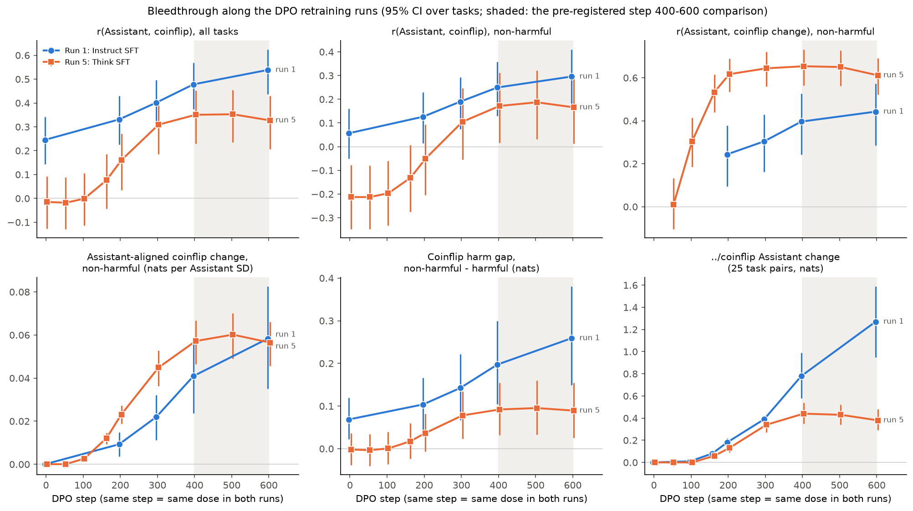

1. **Outcome B, as pre-registered: run 5's broad bleedthrough plateaus with its harm-driven
   effect.**
   - From step 400 to 600, neither r_benign nor b moves, and the harm gap is flat too, as the
     `../coinflip` effect is.
   - The sensitivity check passes: over the same steps both rise in run 1. So the design can
     detect continued growth, and run 5 doesn't have it.
   - It is not C: the change DPO adds to the Think SFT's coinflip is strongly Assistant-aligned
     (r change 0.65 at step 400).
2. **Up to step 400, the Think SFT's benign bleedthrough grows at least as fast as the
   Instruct SFT's.**
   - b is 0.045 vs 0.022 at step 300 and 0.057 vs 0.041 at step 400. Run 1 catches up only at
     step 600 (0.058 vs 0.056).
   - Run 5's r change is higher throughout (0.62-0.65 vs 0.24-0.44). Within origin the two runs
     are similar (r 0.33-0.53 in run 5 vs 0.36-0.66 at step 400). Most of run 5's extra comes
     from math tasks, whose coinflip rises as a group (+0.09 at step 400, against -0.04 for
     Alpaca), and the Assistant likes math most.
   - The harm gap grows equally in both runs to step 300 (+0.08 and +0.07 from step 0), and then
     only run 1's keeps growing (+0.19 by step 600, run 5 +0.09).
   - So the Think SFT doesn't lack broad bleedthrough. It stops gaining it at the same step as
     the harm contrast.
3. **The raw r understates run 5's bleedthrough, because of the Think SFT's own coinflip.** At
   step 0, r_benign is -0.21 (the 3.1 Think final's: -0.27). Raw r_benign climbs to
   +0.17-0.19 and plateaus there, while r change is ~0.6.

   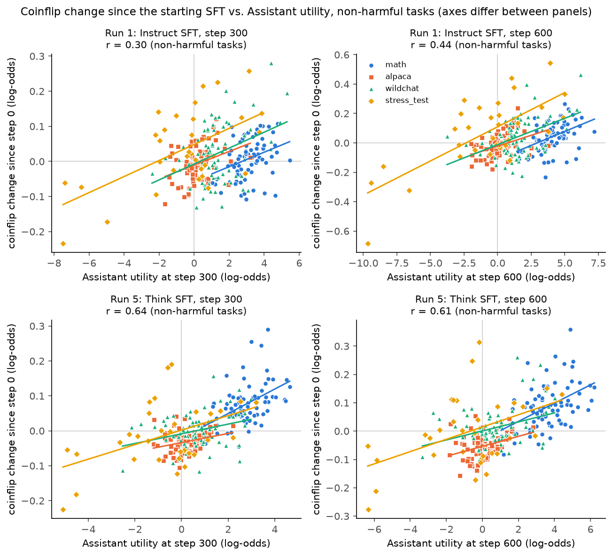
4. **After step 400, run 5's coinflip still moves, but not toward the Assistant.**
   - In run 5, the step 400 → 600 coinflip change (SD 0.025 nats; run 1 0.035) is unrelated to
     the step-600 Assistant: r = -0.08 [-0.20, +0.04]. It is also unrelated to the earlier DPO
     change (+0.06). It correlates +0.60 [+0.49, +0.70] with the Think SFT's starting coinflip:
     late training amplifies the starting structure.
   - In run 1 the late change continues the earlier one (r 0.74) and stays Assistant-aligned
     (0.50).
   - This is `../coinflip`'s linearization result (run 5's updates stop pointing along the
     coinflip gradient after step 400), seen here across the whole task range.
5. **The plateau shows up in every origin.** b within origin, step 400 → 600:

   | origin | run 5 | run 1 |
   |---|---|---|
   | math | 0.039 → 0.039 | 0.031 → 0.044 |
   | Alpaca | 0.012 → 0.015 | 0.023 → 0.030 |
   | WildChat | 0.019 → 0.022 | 0.046 → 0.059 |
   | non-harmful STRESS-TEST | 0.059 → 0.057 | 0.116 → 0.169 |

6. **The Assistant side keeps changing; the coinflip doesn't follow.**
   - Run 5's Assistant SD grows from 3.43 to 3.94 between steps 400 and 600, with its ordering
     fixed (r with step 600 = 1.000), as in the 7B.
   - The two Assistant readings agree at every step (r 0.986-0.992).
   - The fixed-Assistant version tells the same story (r_benign 0.19 at step 400, 0.17 at 600).

**For the safety-pair lead.** The non-harmful measure plateaus at the same step as the harm
contrast, in every origin. So run 5's `../coinflip` plateau is not an artifact of that repo's
pairs being mostly about safety. If the Think SFT fitting the safety pairs early matters, it
would have to stop bleedthrough everywhere, not only for harm. That is possible, but it isn't
the simple reading. The data look more like a general stop on the Think SFT around step 400,
in line with the collapse of update alignment in `../coinflip`'s linearization.

Findings 2-6 were not pre-registered. Caveats:
- One seed per run.
- Run 5 stops at step 600 (45% of run 1's dose), so a later restart of growth isn't ruled out.
- The harm contrast rests on 43 tasks and is small here (0.1-0.26 nats).
- Run 1 is measured here only to step 600. Its final released model has r = 0.65 (`d8ysbybo`),
  which fits continued growth.

## Logit lens: OLMo 3.1 32B Instruct across depth

How the coinflip's Assistant-like preferences build up over the network. Both
conditions are read at every depth with the logit lens, as in `../coinflip`'s
`logit_lens.py`: the residual stream at the last prompt position (after "I'll choose
Task" or "it came up") goes through the final norm and the unembedding. Depth d is
the stream after d decoder blocks: 0 is the embeddings and L = 64 is the model's
output. `../coinflip` found OLMo's lens puts most of its mass on " heads"/" tails"
from about depth 30-35.

### Design

- `lens.py`, config `configs/lens/olmo3.1-32b-instruct.yaml`: the final Instruct model
  only, both conditions, no system prompt, the models-group pairs (15,000 of 44,850,
  both orders): the same 60,000 prompts as `d8ysbybo`'s Instruct stage restricted to
  those pairs. Per prompt and depth it saves log P of the two outcome tokens, the
  lens's top token and the entropy.
- `lens_analysis.py` fits utilities at each depth from the lens log-odds, exactly as
  `analyze.py` does from the output's, and compares the coinflip utilities at depth d
  with two Assistant scales:
  - (a) the final Assistant utilities (the model's output), and
  - (b) the Assistant utilities read by the lens at the same depth d.

### Pre-registered before running (2026-10-28)

- **Readability rule** (as `../coinflip`): a depth is readable for a condition if
  the median P(first) + P(second) over its prompts is at least 0.10. Statistics at
  unreadable depths are plotted faded and not interpreted. (a) needs the coinflip
  readable at d; (b) needs both conditions readable at d.
- **Validation gate.** At depth L the lens must match the model's output per prompt
  (0.5 nats, checked by `lens.py`). The output log-odds must reproduce `d8ysbybo`'s
  Instruct rows for the same prompts (median |difference| at most 0.05 nats; same
  GPU type, A100), and the depth-L utilities must correlate at least 0.999 with
  `d8ysbybo`'s on these pairs, in both conditions. If either fails, nothing is
  interpreted until the cause is found.
- **Measures per depth:** Pearson r between coinflip and Assistant utilities with a
  95% task-bootstrap CI (both versions, all tasks and benign only), the slope of
  coinflip on Assistant utilities, the coinflip utilities' SD and split-half
  reliability, and the median outcome mass per condition.

Questions, all descriptive, with no predicted direction:
1. **Onset.** The shallowest readable depth from which r (a) has a CI above zero at
   every deeper readable depth. If it is the first readable depth, the lens only
   bounds when the correlation arises.
2. **Peak vs output.** The largest r (a) at a readable depth against r at depth L,
   paired over task bootstraps. r counts as falling off in the last blocks only if
   the paired difference (depth minus L) has a CI above zero at 3 or more
   consecutive depths. The same for the coinflip utilities' SD (`../coinflip`'s
   effect peaked at depth 56 at twice its output size).
3. **(a) vs (b).** Does the coinflip at depth d track the same-depth Assistant
   utilities more or less than the final ones? Paired bootstrap difference
   r (b) - r (a) per readable depth.
4. **Assistant convergence.** r between the Assistant utilities at depth d and at L:
   where does the Assistant's own ranking settle, relative to the coinflip's onset?

### Results (2026-10-28)

Run `9kbknjwm` (1x A100 SXM, 38 min of scoring, $1.32). Per-depth table:
`outputs/lens/9kbknjwm/analysis/per_depth.csv` (not in git; the raw `.npz` files are in
the W&B run's files).

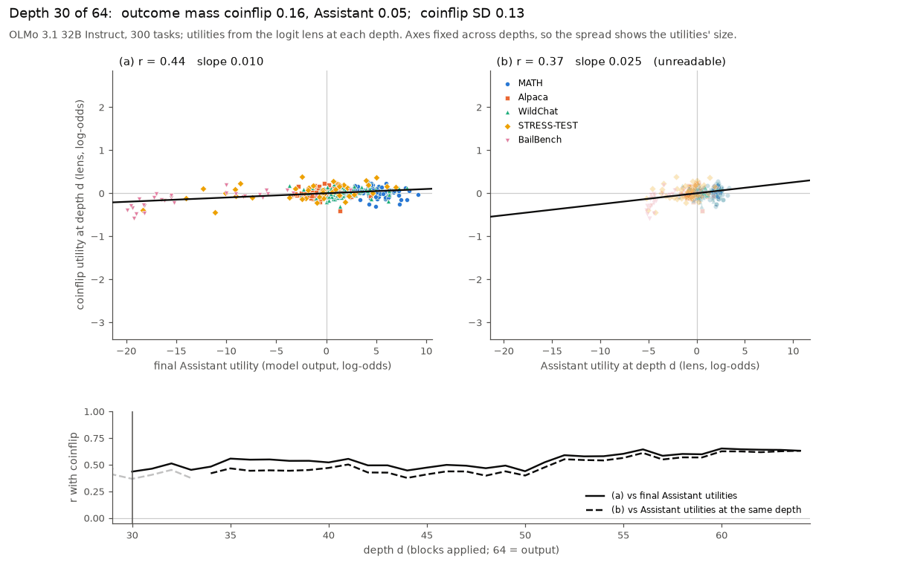

`figures/lens_scatter.gif` (and `.mp4`) runs from depth 30, where the coinflip
first becomes readable, to the output. Left (a): coinflip utilities at depth d against
the final Assistant utilities. Right (b): against the Assistant utilities at the same
depth (faded where the Assistant condition is unreadable). Axes are fixed across
depths, so the spread shows how big the utilities are. Below the scatters, r by depth.
Stills: `figures/lens_scatter_depth30.png`, `figures/lens_scatter_depth64.png`.
Summary: `figures/lens_depth.png`.

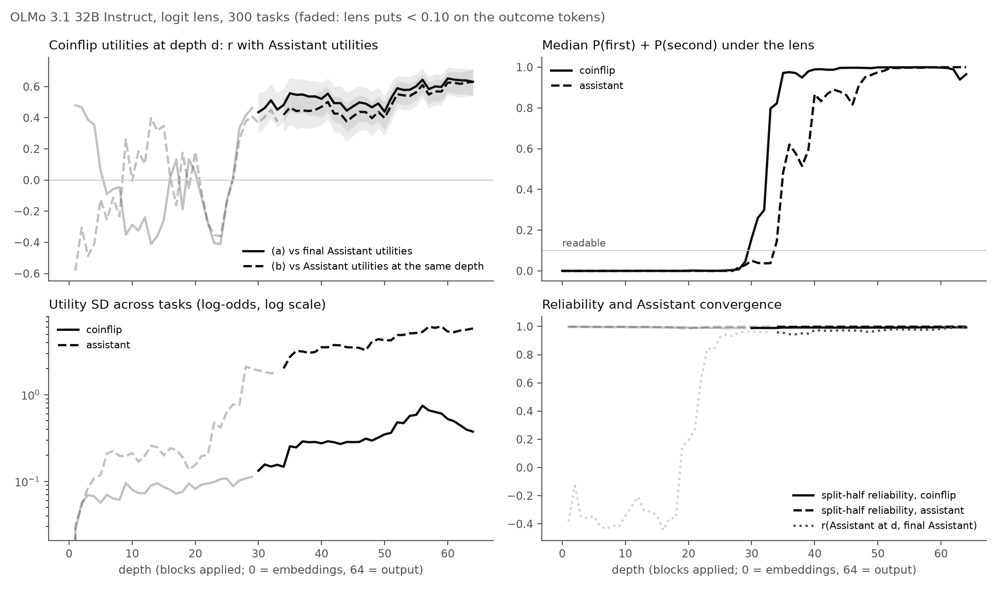

**Validation passes.** At depth 64 the lens equals the model's output exactly (0 nats
for every prompt). The output log-odds reproduce `d8ysbybo` (median |difference|
1e-7 nats; max 0.75 in the Assistant condition and 0.38 in the coinflip, bf16 rounding
by batch composition in a few prompts). Depth-64 utilities correlate 1.0000
(Assistant) and 0.9998 (coinflip) with `d8ysbybo`'s on these pairs.

**Readability.** The coinflip is readable from depth 30 (median mass 0.16, 0.97 by
depth 35), as in `../coinflip`. The Assistant's " A"/" B" become readable later, from
depth 34 (0.86 by depth 40).

| depth | r (a) [95% CI] | r (b) | r (a), benign | coinflip SD | slope (a) |
|---|---|---|---|---|---|
| 30 | 0.44 [0.30, 0.56] | (0.37) | 0.17 | 0.13 | 0.010 |
| 36 | 0.55 [0.42, 0.65] | 0.44 | 0.32 | 0.25 | 0.023 |
| 44 | 0.45 [0.31, 0.56] | 0.38 | 0.20 | 0.29 | 0.022 |
| 52 | 0.59 [0.49, 0.67] | 0.55 | 0.39 | 0.48 | 0.049 |
| 56 | 0.64 [0.56, 0.72] | 0.61 | 0.46 | **0.75** | 0.083 |
| 60 | **0.65** [0.57, 0.72] | 0.63 | 0.47 | 0.53 | 0.059 |
| 64 (output) | 0.63 [0.54, 0.71] | 0.63 | 0.40 | 0.38 | 0.041 |

Answers to the pre-registered questions:

1. **Onset: the correlation is there as soon as the coinflip is readable.** At depth
   30, r (a) = 0.44 [0.30, 0.56], and its CI stays above zero at every deeper depth.
   So the lens only bounds the onset. About two thirds of the output's correlation is
   in place by the first readable depth, and r reaches 0.55 by depth 35.
2. **Peak vs output: the size falls off at the end, the correlation doesn't.**
   - r (a) peaks at depth 60 (0.65) against 0.63 at the output. No depth's paired
     difference has a CI above zero, so r does not fall off in the last blocks.
   - The coinflip utilities' SD does: it doubles from depth 48 to 56 (0.30 to 0.75),
     then halves to 0.38 by the output. The paired CI is above the output's at
     depths 52-63 (12 consecutive), the same late damping as `../coinflip`'s effect
     (peak at depth 56, twice the output). The last 8 blocks shrink the coinflip's
     preferences without making them less Assistant-like.
3. **(a) vs (b): the coinflip tracks the final Assistant ranking slightly better than
   the same-depth one,** at every depth where both are readable (34-63; the paired
   CI of r (b) - r (a) is below zero at each). The gap is 0.01-0.10, largest at
   depths 35-39, and gone at the output. The same-depth Assistant utilities
   correlate 0.94-0.99 with the final ones over this range, so (b) is roughly
   (a) with some lens noise added in x. Nothing here suggests the coinflip follows
   an intermediate Assistant state that differs from the final one.
4. **The Assistant's ranking settles early, before it is readable.** The Assistant
   utilities at depth d correlate at least 0.9 with the final ones from depth 25
   on, before the lens puts 10% mass on " A"/" B" (depth 34). The A-vs-B logit
   difference already orders tasks like the output while the lens's top tokens are
   still something else. That's under the readability threshold, so treat it as a
   pointer, not a finding.

Exploratory, not pre-registered:

- **Harm first, then everything else.** Within origin, against the final Assistant
  utilities:

  | depth | MATH | Alpaca | WildChat | STRESS-TEST | BailBench |
  |---|---|---|---|---|---|
  | 32 | -0.06 | 0.10 | 0.10 | 0.51 | 0.70 |
  | 36 | 0.26 | 0.36 | 0.21 | 0.69 | 0.69 |
  | 52 | 0.45 | 0.49 | 0.41 | 0.75 | 0.71 |
  | 56 | 0.58 | 0.56 | 0.50 | 0.75 | 0.75 |
  | 64 | 0.39 | 0.47 | 0.48 | 0.75 | 0.76 |

  Within the harm-related sources the coinflip tracks the Assistant from the first
  readable depth. Within the benign sources it starts near zero and builds up over
  depths 36-56. This is the benign-only r rising from 0.17 to 0.47. The last blocks
  then take some of it back in MATH (0.58 to 0.39) but not in the harm sources.
- **The late bulge is mostly harm.** BailBench's mean coinflip utility goes from
  -0.25 (depth 44) to -1.02 (depth 56) and back to -0.53 at the output. STRESS-TEST
  goes from +0.16 to +0.52 and back to +0.21; it sits above zero throughout,
  despite middling Assistant utilities. In `../coinflip`'s terms this is the
  harmful-vs-benign effect peaking at depth 56.
- Below depth 30 the lens's r swings between -0.6 and +0.5 (`figures/lens_depth.png`,
  faded). The outcome mass there is under 1%, so these are not interpreted, as
  pre-registered.

Caveats:
- One model, one template, no system prompt; the logit lens assumes intermediate
  residuals are already in the output basis, which is least true just above the
  readability threshold.
- Utilities are log-odds, and lens log-odds grow with depth as the lens sharpens. So
  SDs and slopes compare across depths only roughly; r doesn't depend on scale.

## Preference probe: OLMo 3.1 32B SFT and DPO

Does the coinflip borrow the Assistant's preference mechanistically? `../coinflip`'s circuit work
(its RESULTS.md, "Circuit, stage 1" onwards) found that DPO's weight change behind the coinflip effect
sits in blocks 8-23, diffuse across thousands of neurons, upstream of "finder" heads (L20H39, L21H2,
L22H3) that attend from the last token to the harmful task. Two readings of what that change does:

- **(a)** the SFT already represents each task's value at the coinflip prompt's task tokens, and DPO
  makes it readable to the finder heads;
- **(b)** in a Human-turn prompt the SFT doesn't represent the task's value at all.

A utility probe as in Gilg et al. separates them, and is also the cleanest test of preference vs harm:
every dispreferred task in `../coinflip`'s 25 standard prompts is extremely harmful. Plan:
`PLAN_preference_probe.md`. Exploratory (no pre-registration), with what each test would show written
down below before the data.

### Design

- **Models:** `allenai/Olmo-3.1-32B-Instruct-SFT` and `-DPO`, the checkpoints of the circuit work, bf16
  (their fp32 weights are bf16 values upcast), no system prompt, one 1x H200 pod each.
- **Layers:** "block b" is block b's *output* (matskit `at="post"`, HF `hidden_states[b+1]`), b = 0..63,
  as in `../coinflip/circuits`.
- **Activations** (`probe_acts.py`): every prompt in one forward pass of its own (no padding), for the 300
  tournament tasks plus `../coinflip`'s 10 standard tasks (`probe_prompts.py`):
  - the task alone as the user message, read at `<|im_end|>` (the paper's selector) and at the last token;
  - the tournament's Assistant and coinflip prompts, the task against 4 fixed partners
    (`configs/probe/design.json`: one non-harmful task per source near the median DPO Assistant utility),
    in both slots, read at the token closing the task's text (".\n\n", "?\n\n", a lone "\n\n", or in the
    Assistant prompt's slot B the token before `<|im_end|>`); in the coinflip prompt also at " tails" when
    the task is in slot A. Readouts are averaged over the partners.
- **Fit** (`probe_fit.py`): ridge regression of the DPO model's Assistant utilities (`d8ysbybo`; the
  SFT's as a check) on each site's residual at each block. Nested 5-fold CV (alpha by inner CV);
  features standardized over the fit's rows, without labels, so the Gram matrix can be reused.
  Controls: shuffled utilities (3 permutations), log length partialled out of both sides, leave one
  source out, and a refit on the 257 non-harmful tasks only.
- **Readout** (`probe_readout.py`): probes applied to the other site's and the other model's
  activations.
- **Interventions** (`probe_tests.py`), on `../coinflip`'s 25 standard pairs (token-identical to
  `circuits/pairs.py`, checked in `tests/test_probe.py`) and 300 non-harmful pairs whose DPO Assistant
  utilities differ by at least 2, each in HP and TP order, in the coinflip prompt and `../coinflip`'s
  direct-choice prompt ("I choose Task"):
  - *steering:* +c·s·u on every token of task A and -c·s·u on task B's at block b (u the probe's unit
    direction at b, s the mean residual norm there), b = 15..23 singly and all together;
  - *swap:* shift each task's tokens along u so their mean projection becomes what the other order's
    prompt has in that slot. If the prompt depended on the tasks only through u, HP would become TP:
    share = ((L_TP' - L_TP) - (L_HP' - L_HP)) / 4 / effect.
  - Controls: 3 random directions. Each prompt's arms share a batch of identical rows with one
    unsteered row, so dL is within-batch.

### What each result would mean (written 2026-10-29, before the data)

1. **Probe quality.** The paper got held-out r ≈ 0.83-0.87 with 4,000 tasks. With 300, cross-validated
   r well above the shuffled null and above ~0.7 at some block means the probe is usable; well under
   0.7 means more utilities (ask Hal first).
2. **Harm vs preference.** If the non-harmful-only probe ranks the 43 harmful tasks low (AUROC well
   above 0.5) and ranks the 25 standard pairs right, the direction is a preference that also covers
   harm. If harm is separated only when harmful tasks are in training, the probe is mostly a harm
   detector.
3. **(a) vs (b).** If the SFT's coinflip task tokens carry the utility (a probe fit there, or the
   Assistant-prompt probe applied there) about as well as DPO's, that's (a); much less is (b). Each
   model's probe is applied to the other's activations before reading a difference as a change in
   what's represented.
4. **Causality.** If the coinflip borrows the Assistant's preference through this direction, steering
   moves the choice in both models and the coinflip mostly in DPO, well beyond random directions, and
   the swap carries a sizable share of DPO's coinflip effect. Steering that moves the choice but not
   the coinflip, or a swap share near the random directions', means the coinflip reads the tasks
   some other way.

### Results (2026-10-29)

Two 1x H200 pods (SFT and DPO), $10.19 in all. Extraction took 5-10 min per model, and the
interventions 25-28 min. Checks:
- **Prompts:** the extraction prompts' own log-odds reproduce the tournament's utilities (task
  mean over partners vs `d8ysbybo`: r 0.994/0.996 for the Assistant prompt, 0.935/0.956 for the
  coinflip, SFT/DPO).
- **Batch drift:** under the interventions' batching, the unsteered row is a median of 0-0.06 nats
  (max 0.25) from the unbatched forward. Every dL is taken within its batch.

Numbers are in `outputs/probe/` (not in git): `{sft,dpo}/fit_summary.json`, `readout.json`,
`effects.json`.

**1. The probes fit well, in both models.**

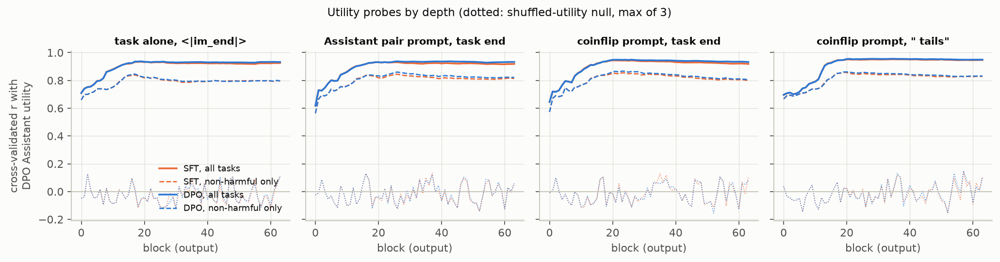

- **Fit:** the DPO Assistant utilities are read at cross-validated r = 0.93-0.96 from block ~18 on,
  at every site, with the same curves in SFT and DPO. The best blocks:
  - task alone, `<|im_end|>`: 0.93/0.94 (block 19);
  - pairwise Assistant prompt: 0.93/0.94;
  - coinflip task tokens: 0.94/0.95;
  - coinflip " tails": 0.95/0.96.
- **Controls:** the shuffled-utility null peaks at 0.13. Partialling out log length changes r by
  under 0.005. Refit on the SFT's own utilities, r is 0.93-0.96.
- **Between vs within sources:** most of the utility variance (67%) lies between the five task
  sources. Random-fold predictions still rank tasks within each source (r 0.67 Alpaca, 0.76 MATH,
  0.73-0.83 STRESS-TEST, 0.45-0.58 WildChat, 0.9 BailBench). But a probe that never saw a source
  misplaces that source's level: leave-one-source-out pooled r is only 0.20-0.34. With 300 tasks
  this is much weaker than the paper's held-out-topic r ≈ 0.85 with 4,000.
- **Two probe positions:** the single-task (`<|im_end|>`) probe and the pairwise probe are different
  vectors (cosine 0.5 at block 19, falling to 0.1 by block 63), but they predict each other's
  sites (cross-fitted r 0.91 and 0.93 at block 19).

**2. Preference, not just harm.**

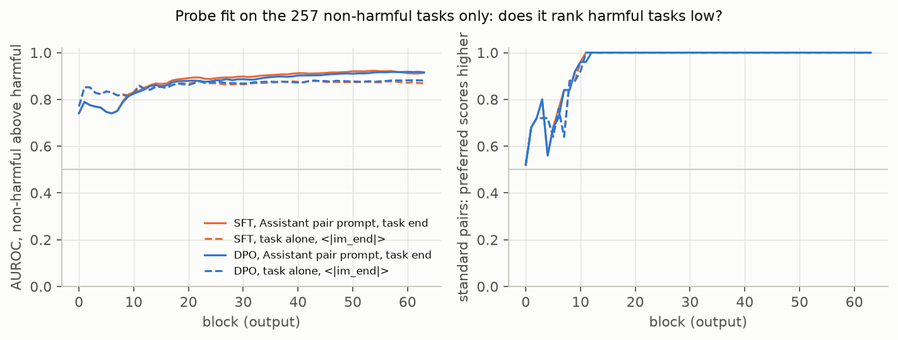

The probe fit on the 257 non-harmful tasks only:
- predicts held-out non-harmful tasks at r 0.79-0.88;
- ranks the 43 harmful tasks below them (AUROC 0.86-0.91 at blocks 15-40, about 2 SD lower on
  average);
- ranks all 25 standard pairs correctly from block 11 on.

So this is a preference direction that also covers harm. It's not a harm detector: harm separates
without harmful tasks in training. Its direction is at cosine ~0.65-0.70 to the all-task probe's.

**3. Reading (a): the SFT already represents the tasks' values at the coinflip's task tokens.**

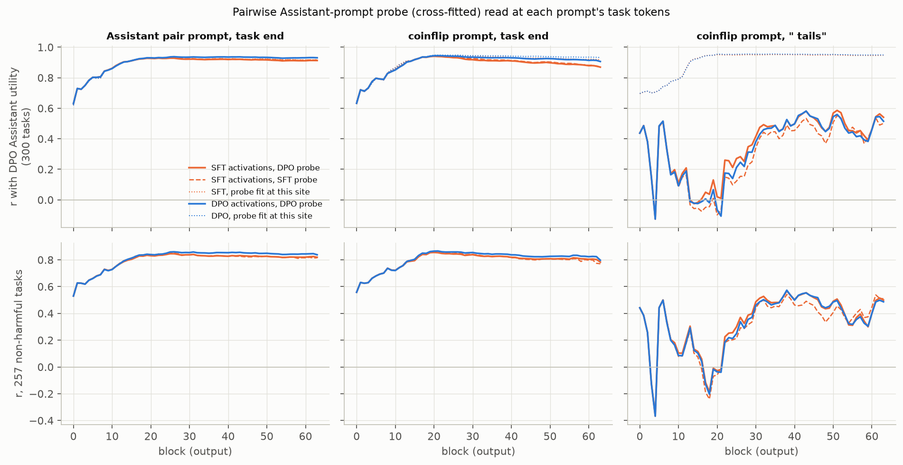

The pairwise Assistant-prompt probe, cross-fitted so no task is scored by a probe that saw its
utility, read at the coinflip prompt's task tokens gives r = 0.94 at block 20 in *both* models
(0.86 within non-harmful tasks).
- The DPO model's probe reads the SFT's activations as well as the SFT's own probe does (0.941 vs
  0.942).
- The two models' probes are nearly the same vector (cosine 0.96-0.99 at blocks 15-23).
- So the value representation at the task tokens is shared and unchanged by DPO.
- At " tails" a probe fit there reaches 0.95 in both models. The task-token probe doesn't read it
  before block ~25 (r ≈ 0 at blocks 13-21): the label token carries the value in a different
  direction.

(A first version of this figure applied the full-data probes to the same tasks' activations at
other sites, which inflated those curves to r ≈ 1.)

**4. The direction is causal for both decisions; DPO amplifies the coinflip's read of it.**

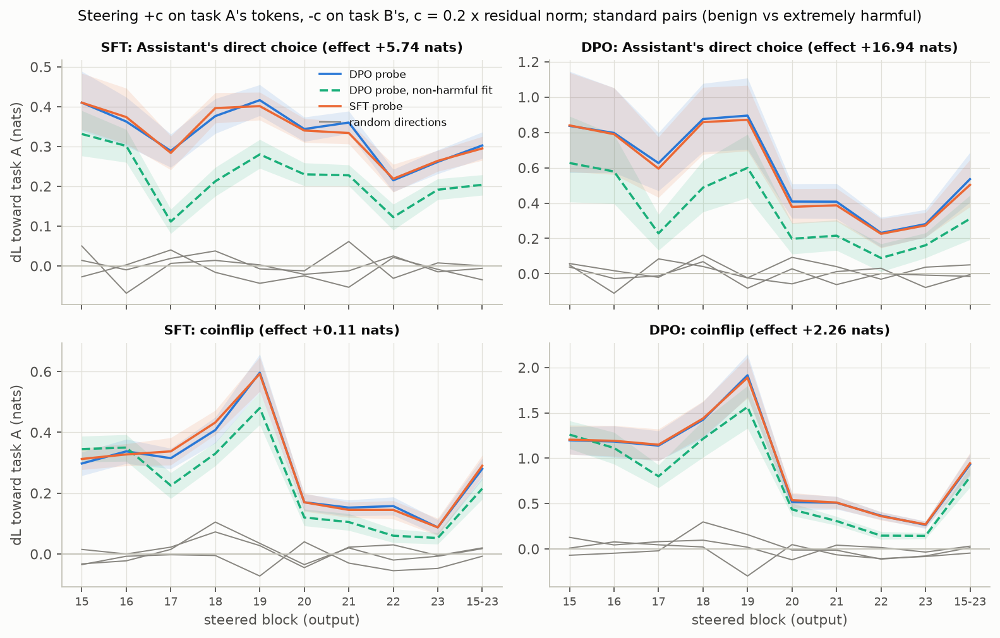

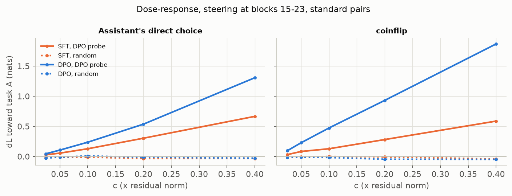

Steering with c = 0.2 × the residual norm (about 2 SD of the probe projection's spread across tasks,
applied with opposite signs to the two tasks), at block 19, standard pairs, change in log-odds toward
task A:

| | coinflip | direct choice |
|---|---|---|
| SFT, probe | +0.60 | +0.42 |
| DPO, probe | **+1.91** | +0.90 |
| random directions (3, both models) | -0.30 to +0.16 | -0.08 to 0.00 |

- At c = 0.4: DPO coinflip +3.7 [3.3, 4.0] and choice +2.1; SFT coinflip +1.4 and choice +0.9.
- Effects are largest at blocks 15-19 and drop sharply after block 19, where `../coinflip`'s finder
  heads (blocks 20-22) read the tasks.
- The DPO probe, the SFT probe and the non-harmful-only probe all work. The last is somewhat
  weaker (DPO coinflip +1.56 at block 19).
- The non-harmful pairs agree: DPO choice +1.30 and coinflip +0.13 at c = 0.1 (block 17), against
  baseline effects of 3.28 and 0.16 nats.

Against the prediction: the SFT's coinflip *does* respond to the direction, with a third of DPO's
gain, although its coinflip effect is only 0.11 nats. Per unit of steering the coinflip responds
more than the Assistant's own direct choice, in both models, and DPO raises both gains about
2-3×.

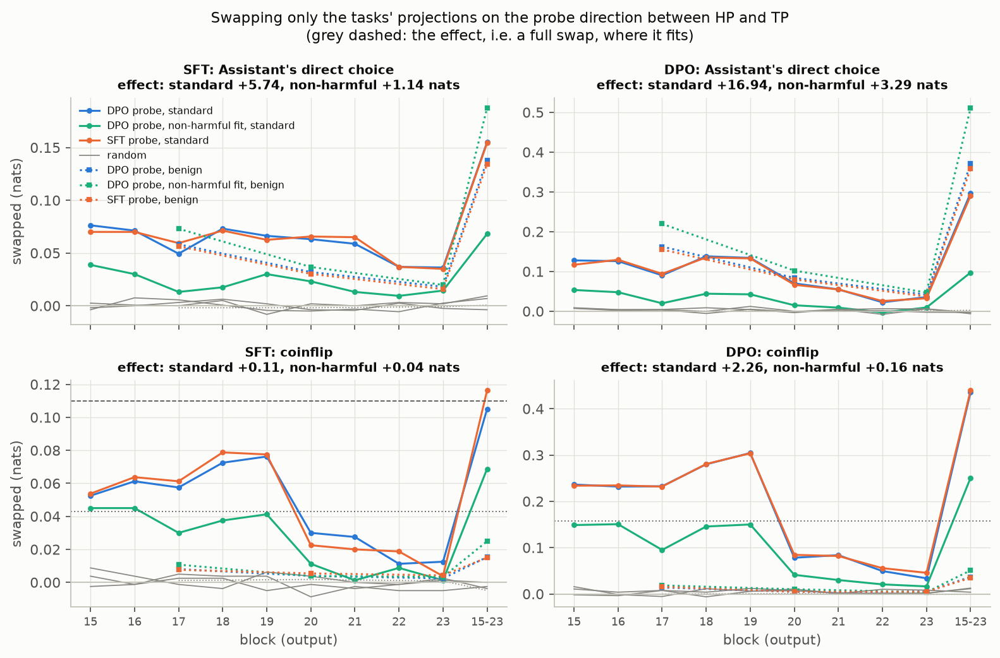

**Swap.** Moving only the tasks' projections on the probe direction into the other order's values,
at blocks 15-23 together (the change in nats is plotted; shares below):

| | coinflip, standard | coinflip, non-harmful | choice, standard | choice, non-harmful |
|---|---|---|---|---|
| DPO, DPO probe | **19% [16, 24]** (0.44 of 2.27 nats) | 23% [17, 34] | 2% (0.30 of 16.95) | 11% |
| DPO, non-harmful probe | 11% | 32% | 1% | 16% |
| SFT, DPO probe | ~100% (0.105 of 0.10 nats; CI wide) | 0.015 of 0.04 nats | 3% | 12% |
| random | ≤ 1% | ≤ 1% | 0% | 0% |

- Single blocks carry 10-14% of the DPO coinflip effect at blocks 15-19, and 2-4% from block 20 on.

**Reading.**
- The task-value direction is the same in SFT and DPO, and present at the coinflip's task tokens in
  both: reading (a).
- It is causal for the coinflip in both models, and DPO makes the coinflip about 3× more sensitive
  to it.
- Under natural task differences, though, it carries only about a fifth of DPO's coinflip effect
  (0.44 of 2.27 nats; the SFT's whole effect is about 0.1). So most of what DPO added to the
  coinflip's dependence on the tasks runs through other features at blocks 15-23, or outside
  the task tokens.
- The direct choice depends on this direction even less under natural differences (2% of its
  17-nat effect).

**5. The label B token (follow-up with the `../coinflip` circuit agent, same day).** The circuit
work finds that " tails" carries about a quarter of DPO's coinflip effect at blocks 18-24 (residual
patching), and point 3 shows it holds the value in a direction of its own. So the label B outcome
word was tested causally: " tails" in the coinflip prompt and " B" ("Task B:") in the direct-choice
prompt. Two more 1x H200 pods, $7.86.

- **Setup:**
  - *What it can encode:* the label B token comes after task A's text and before task B's, so with
    causal attention its residual depends on task A alone. Any task-B term is exactly zero, so the
    probes regress on u_A, task A's utility.
  - *Extraction:* " B" was extracted from `../coinflip`'s choice prompt, one prompt per task with the
    task in slot A (`probe_acts.py --kinds choice`).
  - *Probes:* label probes were fit as before (`probe_fit.py --tag _label`), with directions
    `label_<prompt>_probe_*` in `directions.npz`.
  - *Arms* (`probe_tests.py --label`):
    - steering the label token alone along its probe, on the same dose scale;
    - swapping its projection to the other order's value;
    - that swap combined with the task-token swap (along the task probe), at blocks 15-23 together
      and singly.
- **Which scale the label token reads:** the Assistant utilities fit best, DPO's and SFT's equally
  (cross-validated r 0.95-0.97 at both labels, both models). Next come the DPO coinflip utilities
  (0.82-0.84) and the SFT coinflip utilities (0.68-0.73).
- **Its own direction:** the label probes are nearly orthogonal to the task-token probe (cosine
  0.00-0.11 at blocks 15-23). " tails" and " B" have different directions (0.19-0.29), and each is
  the same in SFT and DPO (0.91-0.99). The cross-fitted task-token probe partly reads " B" (r
  0.55-0.67) but not " tails" before block 25 (r ≈ 0).

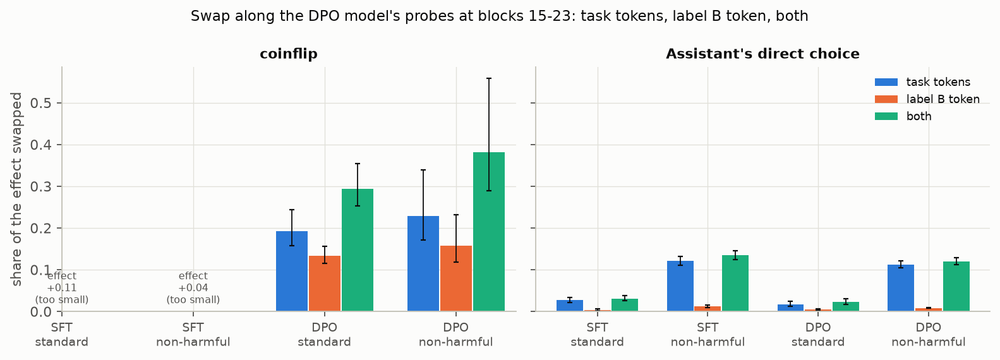

Share of the effect swapped at blocks 15-23 together, along the DPO model's probes. Brackets are 95%
pair-bootstrap CIs. Where the effect is under 0.15 nats (SFT coinflip) the change is given in nats.
The random directions are the range over 3.

| model | prompt | pairs | effect (nats) | task tokens | label B | both | random (task / label / both) |
|---|---|---|---|---|---|---|---|
| SFT | coinflip | standard | +0.11 | +0.105 nats | +0.058 nats | +0.156 nats | ±0.01 nats |
| SFT | coinflip | non-harmful | +0.04 | +0.015 nats | +0.009 nats | +0.028 nats | ±0.01 nats |
| SFT | choice | standard | +5.74 | 3% [2, 3] | 0% [0, 1] | 3% [3, 4] | 0% |
| SFT | choice | non-harmful | +1.14 | 12% [11, 13] | 1% [1, 1] | 13% [12, 15] | 0% |
| DPO | coinflip | standard | +2.26 | 19% [16, 24] | 13% [12, 16] | **29% [25, 35]** | 0-1% |
| DPO | coinflip | non-harmful | +0.16 | 23% [17, 34] | 16% [12, 23] | **38% [29, 56]** | -4 to -1% |
| DPO | choice | standard | +16.94 | 2% [1, 2] | 0% [0, 1] | 2% [2, 3] | 0% |
| DPO | choice | non-harmful | +3.29 | 11% [10, 12] | 1% [1, 1] | 12% [11, 13] | 0% |

- **The label token matters for the coinflip, not the choice.** In DPO the label swap alone carries
  13-16% of the coinflip effect, and with the task tokens 29-38%, close to the sum of the two
  parts. In both models it carries at most 1% of the direct choice.
- **Where along the depth:** swapped one block at a time, the label's share of DPO's coinflip peaks
  at blocks 20-21 (0.24 and 0.20 nats, about 10%), against 0.09-0.16 at blocks 15-19. That's
  where the circuit work puts the readers' keys at " tails". The task tokens peak earlier (blocks
  15-19).
- **The SFT** (coinflip effect ~0.1 nats) shows the same pattern in nats: the label swap moves it
  0.058, and both together 0.156, more than its whole effect.

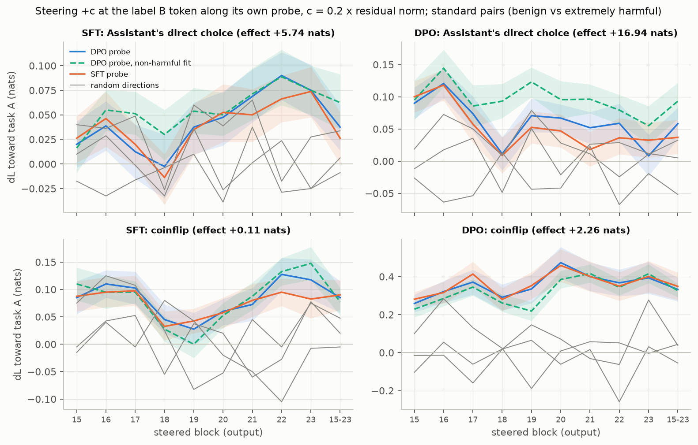

**Steering the label token** along its own probe (one token, against the task tokens' 20-40):
- DPO coinflip: +0.26 to +0.47 nats at c = 0.2, peaking at block 20; +0.75 [0.61, 0.89] at c = 0.4
  over blocks 15-23.
- DPO direct choice: +0.01 to +0.12.
- SFT: 0.00 to +0.13 (coinflip +0.03 to +0.13, choice 0.00 to +0.09).
- Random directions at a single token are noisy: -0.26 to +0.28 nats in DPO's coinflip at single
  blocks, and ±0.06 over 15-23. So only DPO's coinflip clearly beats them at single blocks.

**Reading.**
- DPO's coinflip reads the task values from two places: the task tokens (the Assistant's value
  direction) and the " tails" label word, which carries task A's value in a separate direction.
  The latter is read around blocks 20-21.
- Along these two 1-D directions the swaps account for about 30% (standard pairs) to 40%
  (non-harmful) of the effect. The rest goes through other directions or other tokens.
- The Assistant's direct choice barely uses the label token (≤ 1%).

Caveats:
- **Probe vs read direction:** a ridge probe is fit to predict, not to match the direction the
  model reads. A 1-D swap underestimates mediation when the model reads a nearby direction, while
  steering doesn't need an exact match.
- **Scope of the swap:** it moves only the task tokens' mean projection at blocks 15-23. Label and
  ending tokens are untouched; " tails" carries the value in its own direction (point 3).
- **Sample:** 300 tasks, one prompt template per condition, 4 fixed partners, bf16 on H200.
- **Format:** steering and swap use `../coinflip`'s direct-choice wording ("I choose Task"), not
  the tournament's ("I'll choose Task"), to match the circuit work. The probes were fit in the
  tournament's format.

## Tasks

From the canonical 6,000-task set of Gilg et al., [Probing Persona-Dependent
Preferences in Language Models](https://arxiv.org/abs/2605.13339)
([code](https://github.com/oscar-gilg/probing-persona-preferences), upstream commit
`11869a5`): Alpaca, competition MATH, WildChat, BailBench and STRESS-TEST, with topic
labels by Claude Sonnet 4.5. The task texts keep their source licenses (WildChat
ODC-BY 1.0, Alpaca CC BY-NC 4.0, MATH MIT, BailBench MIT, STRESS-TEST Apache 2.0); the
MIT license in `LICENSE` covers this repo's code.

- `data/canonical_6000.jsonl`: all 6,000 tasks with origin, topic and source metadata.
- `data/tasks_n100_max500_seed0.jsonl`: first working subsample. 100 tasks of
  at most 500 characters, drawn with the upstream source quotas
  (25% MATH / 25% Alpaca / 25% WildChat / 15% STRESS-TEST / 10% BailBench).

Regenerate with `make_tasks.py` (see its docstring).

Some tasks describe seriously harmful requests. They are used only as stimuli:
we read choice/outcome token probabilities and never generate completions.
